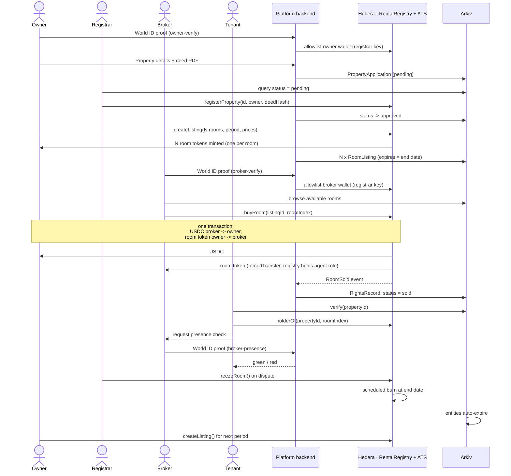

# Rent Me Out

**Rental Rights - now Tokenised !!.**

An owner tokenises the right to rent out each room for a fixed period, a broker buys that right (by buying the token - owing the rental rights) with a one-time payment, and only the token holder can rent the room out until it expires. No duplicate brokers. No fake agents. No trust required — just verify on-chain.

> Built at ETHGlobal Mumbai 2026

---

## Table of Contents

- [The Problem](#the-problem)
- [The Solution](#the-solution)
- [How It Works](#how-it-works)
- [Architecture](#architecture)
- [Partner Tracks](#partner-tracks)
  - [Hedera — Chain of Record](#hedera--chain-of-record)
  - [World — Human Verification via Selfie Check](#world--human-verification-via-selfie-check)
  - [Arkiv + Swarm — Public Data Layer](#arkiv--swarm--public-data-layer)
- [Smart Contracts](#smart-contracts)
- [Tech Stack](#tech-stack)
- [User Flows](#user-flows)
  - [Owner Flow](#owner-flow)
  - [Registrar Flow](#registrar-flow)
  - [Broker Flow](#broker-flow)
  - [Tenant Verification Flow](#tenant-verification-flow)
- [Edge Cases and Failure Handling](#edge-cases-and-failure-handling)
- [Screens](#screens)
- [API Endpoints](#api-endpoints)
- [Repo Structure](#repo-structure)
- [Setup and Running](#setup-and-running)
- [Demo](#demo)
- [World ID Integration Debrief](#world-id-integration-debrief)
- [AI Usage Statement](#ai-usage-statement)
- [Team](#team)

---

## The Problem

In rental markets across India and many other countries, tenants have no way to verify whether the broker standing in front of them actually has the right to rent out a property. This leads to:

- **Duplicate brokers** — multiple agents claim rights to the same room, each collecting advances from different tenants.
- **Fake agents** — someone with no relationship to the property poses as a broker, collects money, and disappears.
- **No accountability** — tenants have no on-chain or verifiable proof of who holds rental rights, and owners have no control over who represents their property.

The result: tenants lose money, owners lose trust, and honest brokers compete against scammers with no way to prove they're legitimate.

---

## The Solution

**Rent Me Out** uses a master-lease model backed by on-chain tokens:

1. An **owner** tokenises the right to rent out each room for a fixed period (e.g., Jan–Mar 2027).
2. A **broker** buys that right with a one-time USDC payment. The token moves from the owner's wallet to theirs in the same transaction as the payment.
3. Only the **token holder** can rent the room out until the token expires.
4. **Anyone** — tenants, other brokers, platforms — can verify who holds the rights to any room, at any time, without asking permission.

Each room = **1 ERC-3643 token** (supply 1, no decimals). A 3-bedroom flat with all rooms listed = 3 tokens. A broker wanting the whole flat buys all three.

**The owner holds the rights until they sell.** Creating a listing mints one token per room to the owner's wallet, so every listed room is a token that exists and has a holder from the moment it goes on the market. The sale is atomic: `buyRoom()` moves USDC broker → owner and the token owner → broker in a single transaction, so the owner can never take payment and fail to deliver. The owner never sends the token by hand.

Minting happens at **listing**, not at deed approval — the token encodes a specific period (`Jan–Mar 2027`), and the room count, dates and prices aren't known until the owner creates the listing.

A **registrar** (platform-operated) verifies the owner's deed before anything can be minted, ensuring only legitimate properties enter the system.

---

## How It Works



The registrar never appears in the payment path — USDC moves broker → owner inside `buyRoom()`, and the platform never custodies funds or holds a room token. Its only powers are allowlisting wallets, approving properties, and freezing a token during a dispute.

**Seven phases:**

1. **Owner onboarding** — World ID verification, property submission, deed upload to Swarm, application written to Arkiv
2. **Registrar review** — deed review, approve/reject, property registered on Hedera
3. **Listing creation** — rooms, period, price defined; one ERC-3643 token per room minted to the owner via ATS
4. **Broker onboarding** — World ID Proof of Human, wallet added to ERC-3643 KYC list
5. **Purchase** — broker pays USDC and the token moves owner → broker in the same transaction; Arkiv updated
6. **Tenant verification** — verify page shows holder + validity; selfie check confirms broker identity in person
7. **Expiry** — token burns at end date, Arkiv entities auto-expire, owner can re-list

---

## Architecture

```
+------------------+     +-------------------+     +------------------+     +----------------+
|                  |     |                   |     |                  |     |                |
|     Owner        |     |    Registrar      |     |     Broker       |     |    Tenant      |
|                  |     |                   |     |                  |     |                |
+--------+---------+     +---------+---------+     +--------+---------+     +-------+--------+
         |                         |                        |                       |
         +------------+------------+------------+-----------+-----------+-----------+
                      |                         |                       |
               +------v------+          +-------v-------+       +------v------+
               |             |          |               |       |             |
               |  Next.js    |<-------->|  Next.js API  |<----->|  Next.js    |
               |  Frontend   |          |  Routes       |       |  Frontend   |
               |             |          |  (Backend)    |       |  (Verify)   |
               +-------------+          +-------+-------+       +-------------+
                                                |
                      +-------------------------+-------------------------+
                      |                         |                         |
              +-------v--------+       +--------v--------+      +--------v--------+
              |                |       |                 |      |                 |
              |  Hedera        |       |  World ID       |      |  Arkiv          |
              |  Testnet       |       |  (IDKit +       |      |  Testnet        |
              |                |       |   Selfie Check) |      |                 |
              |  - RentalReg.  |       |                 |      |  - Listings     |
              |  - ATS Tokens  |       |  3 actions:     |      |  - Verify Index |
              |  - USDC        |       |  - owner-verify |      |  - Reg. Queue   |
              |  - Scheduled Tx|       |  - broker-verify|      |                 |
              |                |       |  - broker-      |      |  Swarm          |
              |                |       |    presence     |      |  - Deeds (enc.) |
              |                |       |    (selfie)     |      |  - Photos       |
              +---------+------+       +-----------------+      +-----------------+
                        |
                  Source of Truth
                  (token ownership,
                   validity, freeze)
```

**Data ownership:**

| Data | Lives on | Why |
| --- | --- | --- |
| Room token ownership, validity, freeze state | Hedera (ATS + registry) | Source of truth; enforced on-chain |
| USDC payment | Hedera | Settlement and receipt |
| Listings, verify index, registrar queue | Arkiv | Public, queryable, auto-expiring |
| Deed PDFs, photos | Swarm | Decentralised file storage; deeds encrypted |
| World ID nullifiers, owner contact details | Backend database | Private; never published |

---

## Partner Tracks

### Hedera — Chain of Record

**Track:** Tokenize Anything with Hedera Studios ($5,000)

Hedera is the single source of truth for who holds the right to rent each room. All token lifecycle operations settle on Hedera testnet.

**What we use:**

- **Asset Tokenization Studio (ATS):** ERC-3643 security tokens — one per room, supply 1, no decimals. Compliance controls (KYC list, freeze, transfer restrictions) are built in. Tokens are minted to the owner at listing time; `RentalRegistry` holds the ATS **agent role** so it can move a token owner → broker via `forcedTransfer()` inside `buyRoom()`, making the sale atomic without the owner sending anything by hand.
- **Allowlist covers owners and brokers.** Because the owner holds a compliance-restricted token between listing and sale, the owner's wallet is allowlisted on successful `owner-verify`, alongside brokers on `broker-verify`. Any wallet not on the list can neither receive nor hold a room token.
- **RentalRegistry.sol:** custom Solidity contract on Hedera EVM for property approval, listing management, period overlap checks, and atomic room purchases.
- **USDC payments:** broker-to-owner payment in USDC (HTS token on Hedera testnet). Both parties must associate the token first.
- **Scheduled Transactions:** token burn scheduled at purchase time for the listing's end date — automatic expiry with no cleanup code.
- **Freeze:** registrar can freeze a room token during a dispute; `isValid()` returns false.

**Compliance controls demonstrated:** KYC list (only verified brokers can hold tokens), freeze (dispute handling), transfer restriction (unverified wallets blocked), scheduled burn (expiry).

### World — Human Verification via Selfie Check

**Track:** Best Use of IDKit ($2,500)

World ID is the gate into the system. No successful human verification = no way to list a property or hold a room token. We use the **selfie check** concept for a face-based, real-time proof of personhood.

**Three trust moments:**

| Moment | IDKit Action | Credential | Purpose |
| --- | --- | --- | --- |
| Owner lists a property | `owner-verify` | Passport/NFC (production); Simulator in demo | Ties the listing to a real, unique person. Prevents someone tokenising rights to a property they don't own. |
| Broker joins | `broker-verify` | Proof of Human (selfie check) | Prevents one person running multiple broker wallets to hoard rooms or evade a bad record. Uniqueness, not identity. |
| Tenant checks broker at a viewing | `broker-presence` | Proof of Human (fresh selfie check) | The key moment: proves the person physically present is the same human bound to the token-holder wallet. No reveal of identity — just a match. |

**How the selfie check works at a viewing:**

1. Tenant opens the verify page and taps "Verify this broker."
2. The broker completes a fresh World ID selfie check (action: `broker-presence`).
3. Backend compares the new nullifier with the one stored for the token-holder wallet.
4. **Green** = the broker is who they claim to be. **Red** = impostor.

This is the core trust moment of the product: a tenant, standing in a room, can cryptographically verify that the person showing them the property actually holds the on-chain right to rent it out.

**Failure paths demonstrated:**

- Broker cancels verification → Buy button stays disabled, token transfer reverts
- Same person, second wallet → rejected on nullifier match ("This identity is already linked to another wallet")
- Impostor at a viewing → red result on the tenant's screen

### Arkiv + Swarm — Public Data Layer

**Track:** Build on Arkiv, from scratch ($4,000 + $500 Swarm bonus)

Arkiv replaces a traditional database. Its built-in entity expiry matches our time-bound tokens: a listing for Jan–Mar disappears from Arkiv on 31 March with no cleanup code.

**Why Arkiv over Postgres:**
If listings sat in a database, only our app could read them and they'd need cleanup jobs. On Arkiv, owners own their listing data, anyone can query the verify index without our permission, and records expire with the rights they describe.

**Entities:**

| Entity | Key Fields | Expires |
| --- | --- | --- |
| `PropertyApplication` | propertyId, city, status (pending/approved/rejected), deedRef | 30 days after decision |
| `RoomListing` | propertyId, roomIndex, priceUSDC, startDate, endDate, status (available/sold) | Listing end date |
| `RightsRecord` | propertyId, roomIndex, holderWallet, validUntil, tokenAddress, hederaTxId | Listing end date |
| `BrokerProfile` (optional) | wallet, verified, roomsHeld, completedPeriods | None / yearly |

**Swarm:** deed PDFs (encrypted) and property photos are stored on Swarm. Arkiv entities hold references. The encrypted deed reference is never stored in clear text on Arkiv — it is either re-encrypted with the registrar's key or kept in the backend with only a hash on Arkiv.

---

## Smart Contracts

### RentalRegistry.sol (Hedera EVM)

| Function | Caller | Description |
| --- | --- | --- |
| `registerProperty(propertyId, owner, deedHash)` | Registrar | Marks a property as approved; stores the deed hash |
| `createListing(propertyId, roomCount, start, end, prices[])` | Owner | Checks approval + no overlapping period; records listing and mints one ATS token per room to the owner |
| `buyRoom(listingId, roomIndex)` | Broker | Pulls USDC from broker to owner + moves the room token owner → broker via `forcedTransfer()`, in one transaction |
| `cancelListing(listingId)` | Owner | Cancels while all rooms are unsold; burns the owner's unsold room tokens |
| `isValid(listingId, roomIndex)` | Anyone | True if sold, not frozen, and current time is within the listing period |
| `holderOf(propertyId, roomIndex)` | Anyone | Returns the broker holding valid rights, or zero address. An unsold room returns zero even though the owner holds its token — "owner holds it" means nobody has rental rights |
| `freezeRoom(listingId, roomIndex)` | Registrar | Freezes the token via ATS during a dispute |
| `unfreezeRoom(listingId, roomIndex)` | Registrar | Unfreezes after resolution |
| `burnExpired(listingId, roomIndex)` | Anyone / Scheduled Tx | Burns a token after its end date |

**Events:** `PropertyRegistered`, `ListingCreated`, `RoomSold`, `RoomFrozen`, `RoomBurned`

---

## Tech Stack

| Layer | Technology | Notes |
| --- | --- | --- |
| Smart Contracts | Solidity + Hardhat, Hedera testnet (JSON-RPC relay) | Verified on HashScan |
| Room Tokens | Hedera ATS, ERC-3643 | Registrar holds the issuer role; `RentalRegistry` holds the agent role for atomic sales |
| Hedera Native Ops | `@hashgraph/sdk` | Token association, Scheduled Transactions |
| Frontend | Next.js + wagmi/viem, MetaMask | Mobile-friendly verify page |
| Identity | IDKit JS + World Developer Portal | Selfie check; proof validation server-side only |
| Data Layer | `@arkiv-network/sdk`, Arkiv testnet (chain ID 7794095) | SQL-like queries, auto-expiry |
| File Storage | Swarm via `bee-js` | Deeds encrypted before upload |
| Backend DB | SQLite or Postgres | Nullifier-wallet mapping, encrypted deed refs |
| Hosting | Vercel | Live demo link |

---

## User Flows

### Owner Flow

```
Connect Wallet
      |
      v
World ID Verify (owner-verify)
      |
      v
[Backend: validate proof, add owner wallet to ATS allowlist]
      |
      v
Submit Property Details + Upload Deed
      |
      v
[Backend: encrypt deed -> Swarm, write PropertyApplication -> Arkiv]
      |
      v
Wait for Registrar Approval
      |
      v
Create Listing (select rooms, period, price per room)
      |
      v
[Contract: createListing() -> ATS mints N room tokens to owner
                           -> Arkiv: N RoomListing entities]
      |
      v
Receive USDC when brokers buy rooms
```

### Registrar Flow

```
View Pending Applications (Arkiv query: status = pending)
      |
      v
Open Application -> View Deed (decrypted from Swarm)
      |
      v
Approve                              Reject
   |                                    |
   v                                    v
registerProperty() on Hedera     Arkiv entity -> rejected
Arkiv entity -> approved          Owner notified with reason
      |
      v
Monitor Active Rooms
      |
      v
Freeze / Unfreeze tokens in disputes
```

### Broker Flow

```
Connect Wallet
      |
      v
World ID Verify (broker-verify, selfie check)
      |
      v
[Backend: validate proof, add wallet to ATS KYC list]
      |
      v
Browse Marketplace (Arkiv query: status = available, end date > now)
      |
      v
Select Room -> Pay USDC
      |
      v
[Contract: buyRoom() -> USDC to owner, room token owner -> broker]
[Arkiv: RoomListing -> sold, RightsRecord created]
      |
      v
Rent room out off-platform
      |
      v
At viewings: complete selfie check to prove identity to tenants
```

### Tenant Verification Flow

```
Scan QR Code (or enter Property ID)
      |
      v
View Room Details:
  - Current holder wallet
  - Valid until date
  - Verified broker badge
  (Read from Arkiv, confirmed against Hedera)
      |
      v
At Viewing: Tap "Verify This Broker"
      |
      v
Broker completes fresh selfie check (broker-presence)
      |
      v
Backend: compare nullifier with token-holder's stored nullifier
      |
      v
GREEN: Broker is the token holder     RED: Impostor - do not proceed
```

---

## Edge Cases and Failure Handling

| Case | Enforced By | User Sees |
| --- | --- | --- |
| Owner skips World ID | Backend (no proof = no submit) | Submit button stays locked |
| Same person, second wallet | Backend nullifier check | "This identity is already linked to another wallet" |
| Registrar rejects deed | Registrar + Arkiv status | `rejected` with reason; cannot create listings |
| Listing on unapproved property | `RentalRegistry.createListing()` reverts | Error on the listing form |
| Overlapping period for same rooms | `RentalRegistry.createListing()` reverts | "Rooms already listed for part of this period" |
| Unverified broker tries to buy | ATS KYC list (transfer reverts) | Buy disabled; prompt to verify |
| Insufficient USDC | Hedera transfer fails | "Insufficient USDC" or "Associate USDC first" |
| Room already sold | `buyRoom()` reverts | Room shows `sold` |
| Impostor at viewing | Backend nullifier comparison | Red result on tenant's screen |
| Dispute raised | Registrar freezes token | Verify page: "Frozen — under review" |
| Period ends | `isValid()` false; scheduled burn; Arkiv expires | Room disappears from marketplace |
| Owner cancels before sale | `cancelListing()` burns the unsold room tokens; reverts if any room already sold | Listing removed |
| Owner not allowlisted at listing | `createListing()` reverts — ATS cannot mint to a non-allowlisted wallet | "Complete World ID verification first" |

---

## Screens

| Role | Screens |
| --- | --- |
| Owner | Verify (World ID) · Add property + deed upload · My properties (status) · Create listing · Sales |
| Registrar | Pending queue · Application detail (deed viewer, approve/reject) · Rooms (freeze/unfreeze) |
| Broker | Verify (World ID) · Marketplace · Room detail + Buy · My rooms (QR, "prove I'm the holder") |
| Tenant | Verify property (QR or ID) · Live broker selfie check |

---

## API Endpoints

| Endpoint | Description |
| --- | --- |
| `POST /api/world/verify` | Validates IDKit proof; stores nullifier-wallet mapping; for `owner-verify` and `broker-verify`, adds the wallet to the ATS allowlist (registrar key) |
| `POST /api/properties` | Encrypts deed, uploads to Swarm, writes `PropertyApplication` to Arkiv |
| `POST /api/registrar/:id/approve` | Calls `registerProperty()` on Hedera; updates Arkiv entity to `approved` |
| `POST /api/registrar/:id/reject` | Updates Arkiv entity to `rejected` with reason |
| `GET /api/registrar/:id/deed` | Registrar only: fetches and decrypts deed from Swarm |
| `POST /api/listings/:id/issue` | Issues one ATS token per room to the owner (compliance configured); writes `RoomListing` entities to Arkiv |
| `POST /api/presence/start` | Creates a viewing session for broker-presence check |
| `POST /api/presence/verify` | Checks broker's fresh nullifier against the token holder |
| `GET /api/verify/:propertyId` | Arkiv query for room records, confirmed against `holderOf()` on Hedera |
| Event listener (worker) | Watches `RoomSold`, `RoomFrozen`, `RoomBurned` events; updates Arkiv |

---

## Repo Structure

```
/
├── contracts/              # Solidity contracts (RentalRegistry.sol)
├── app/                    # Next.js application (frontend + API routes)
│   ├── page.tsx            # Landing page
│   ├── owner/              # Owner screens
│   ├── registrar/          # Registrar dashboard
│   ├── broker/             # Broker marketplace and rooms
│   ├── verify/             # Tenant verification page
│   └── api/                # Backend API routes
├── scripts/                # Deploy scripts, seed demo data
├── arkiv/                  # Arkiv judging files
│   ├── schema.md
│   ├── friction.md
│   ├── reach.md
│   ├── why-arkiv.md
│   ├── how-you-use-arkiv.md
│   └── swarm.md
├── README.md
└── package.json
```

---

## Setup and Running

```bash
# Clone the repository
git clone https://github.com/<your-org>/rent-me-out.git
cd rent-me-out

# Install dependencies
npm install

# Set up environment variables
cp .env.example .env
# Fill in: HEDERA_ACCOUNT_ID, HEDERA_PRIVATE_KEY, WORLD_APP_ID, WORLD_APP_SECRET,
#          ARKIV_RPC_URL, SWARM_BEE_URL, SWARM_POSTAGE_BATCH_ID, ENCRYPTION_KEY

# Deploy contracts to Hedera testnet
npx hardhat deploy --network hedera-testnet

# Run the application
npm run dev
```

**Prerequisites:**
- Node.js 18+
- MetaMask configured for Hedera testnet (JSON-RPC relay)
- Hedera testnet accounts with HBAR from the faucet
- World Developer Portal app with three actions configured
- Arkiv testnet access (chain ID 7794095)
- Swarm Bee node or gateway with a funded postage batch

---

## Demo

**Demo video:** [Link TBD]
**Live demo:** [Link TBD]

### Contract Addresses (Hedera Testnet)

| Contract | Address | HashScan |
| --- | --- | --- |
| RentalRegistry | TBD | TBD |
| Sample Room Token | TBD | TBD |

### Key Transaction IDs

| Transaction | ID | Description |
| --- | --- | --- |
| TBD | TBD | TBD |

---

## World ID Integration Debrief

**Time to first successful verification:** TBD

**Integration experience:** TBD

**Friction points:** TBD

**Missing capability or docs:** TBD

**The one improvement that would help most:** TBD

---

## AI Usage Statement

This project was built at ETHGlobal Mumbai 2026. AI tools (Claude) were used for:
- Planning architecture and integration strategy
- Scaffolding boilerplate code and contract structure
- Drafting documentation

All integration logic, contract code, and product decisions were authored and reviewed by the team.

---

## Team

Built at ETHGlobal Mumbai 2026.

| Person | Role |
| --- | --- |
| Person A | Chain + Backend — RentalRegistry, ATS tokens, USDC payment, freeze, scheduled burn, event listener |
| Person B | Product + Data — Next.js screens, IDKit + selfie check, Arkiv entities, Swarm uploads, verify page |

---

## License

MIT