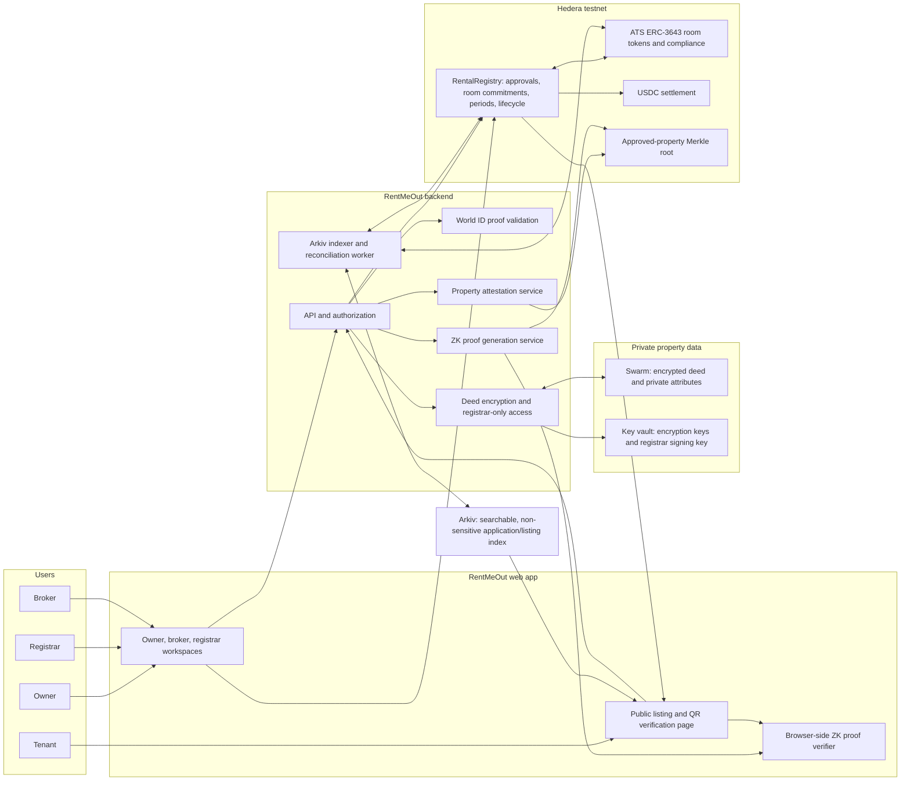
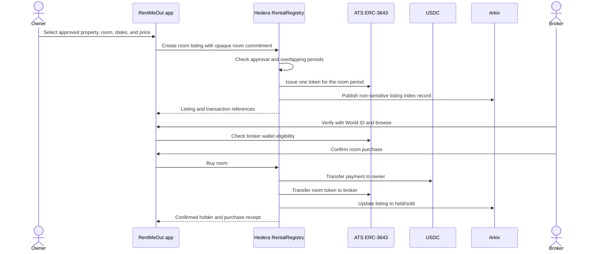

# RentMeOut — System Architecture

This document describes the system in [product.md](./product.md), including a proposed zero-knowledge property attestation flow. It separates the proposal’s existing integrations (Hedera/ATS, World ID, Arkiv, and Swarm) from the additional proof layer.

## 1. Architecture at a glance



### Component responsibilities

| Component | Responsibility | Data it must not expose |
|---|---|---|
| Web app | Role-based screens, wallet prompts, QR verification, local proof verification | Deed files, encryption keys, raw identity proofs |
| Backend API | Authorize actions, validate World ID proofs, orchestrate storage and chain calls | Server secrets to the browser |
| Property attestation service | Create registrar-approved commitments and maintain the approved-property Merkle root | Property opening data in public responses |
| ZK prover | Generate a proof that a hidden property attestation is in the current approved set and matches a room claim | Address, deed, salt, private Merkle path |
| Browser proof verifier | Verify proof against the published verification key and current root | No private witness is needed to verify |
| Hedera RentalRegistry + ATS | Authoritative property/room status, rights period, token lifecycle, holder eligibility | Full address and deed data |
| Arkiv | Searchable application/listing index and public non-sensitive status | Deed contents, cleartext storage pointer, precise private address |
| Swarm + key vault | Store encrypted deeds; restrict decryption to registrar workflow | Publicly readable documents or keys |
| World ID | Prove personhood/uniqueness and support a fresh broker-presence action | Raw ID image or reusable proof in application storage |

## 2. Product and verification flows

### Owner submits a property and registrar attests it

```mermaid
sequenceDiagram
  actor Owner
  participant App as RentMeOut app
  participant ID as World ID
  participant API as Backend API
  participant Swarm
  participant Arkiv
  actor Registrar
  participant Registry as Hedera RentalRegistry
  participant Attest as Attestation service

  Owner->>App: Connect wallet and start property submission
  App->>ID: Owner verification action
  ID-->>App: World ID proof
  App->>API: Proof + property form + deed upload
  API->>ID: Validate proof and uniqueness binding
  API->>API: Normalize property fields; create random salt and commitment
  API->>Swarm: Upload encrypted deed and private attributes
  API->>Arkiv: Write pending application with opaque ID only
  API-->>App: Pending review receipt
  Registrar->>App: Open application
  App->>API: Request authorised deed preview
  API->>Swarm: Fetch encrypted document
  API->>API: Decrypt in registrar-authorised service
  API-->>App: Restricted deed preview
  Registrar->>App: Approve or reject with reason
  App->>API: Approval decision
  API->>Registry: Register opaque property commitment
  API->>Attest: Add approved attestation leaf; update Merkle root
  API->>Arkiv: Update application status
  API-->>App: Final status and transaction references
```

The deed and exact property attributes stay encrypted and private. The public chain receives an opaque commitment and an approved-set root, not the address or document.

### Owner lists a room and broker buys the right



For the demo, use atomic payment and token transfer if ATS permissions support it. If the backend-agent fallback is required, the UI must distinguish **payment confirmed** from **rights transfer confirmed** and reconcile both before showing a completed purchase.

### Tenant verifies a room without seeing the property's real identity on-chain

```mermaid
sequenceDiagram
  actor Tenant
  participant QR as Room QR / opaque room ID
  participant App as Public verify page
  participant Arkiv
  participant Registry as Hedera RentalRegistry + ATS
  participant Prover as ZK prover
  participant Verify as In-browser proof verifier
  actor Broker
  participant ID as World ID

  Tenant->>QR: Scan at the viewing or open a shared link
  QR-->>App: Opaque room ID and proof request
  App->>Arkiv: Fetch public listing/index data
  App->>Registry: Read current room commitment, period, status, and token holder
  App->>Prover: Request proof for opaque room claim and current approved root
  Prover-->>App: ZK proof; no address or deed returned
  App->>Verify: Verify proof locally against current root and room claim
  Verify-->>Tenant: Property approval proof valid / invalid
  Tenant->>App: Start a one-time broker-presence session
  Broker->>ID: Complete fresh broker-presence action
  ID-->>App: Presence proof
  App->>Registry: Re-read current token holder and status
  App-->>Tenant: Green if holder/person binding matches; red otherwise
```

The public result can say **“Registrar-approved property; this room’s rights are current for these dates”** without publishing the address or deed. The broker/tenant may still need the physical address to arrange or attend a viewing; the privacy goal is to keep that identity out of public indexes, chain data, and bystander queries.

## 3. Zero-knowledge property proof design

### What the proof establishes

For a given opaque room identifier, rental period, and current Hedera state, the proof establishes that:

1. The prover knows a hidden property-attestation leaf and its private Merkle path.
2. That leaf is included in the latest approved-property Merkle root published by the registrar on Hedera.
3. The hidden property commitment and room slot derive the opaque room commitment recorded for the specified room token.
4. The attestation is in the current approved set. Revoked/rejected properties must be removed from the active set by publishing a new root, and the verifier must reject proofs against old roots.

The public inputs can be limited to:

- approved-property root and its Hedera block/version;
- opaque room commitment or room ID;
- room token ID, start/end timestamps, and current lifecycle status (read from Hedera);
- proof expiry / challenge nonce to prevent replay of a stale viewing result.

The private witness contains the real address or parcel details, random commitment salt, attestation fields, and Merkle path. The verifier learns no private witness from proof verification.

### Commitment and attestation lifecycle

1. **Normalize and commit:** Backend canonicalizes the address/property attributes and creates a high-entropy random salt. Compute a hiding commitment such as `propertyCommitment = Poseidon(normalizedPropertyData, salt)`. Never use a plain hash of a street address; addresses are guessable and can be brute-forced.
2. **Registrar review:** Registrar checks the deed and whatever physical/official evidence is required. Approval signs or authorizes an attestation over the opaque commitment, status, and credential version.
3. **Publish approved set:** Add an approved attestation commitment to a Merkle tree. Publish only the root and version on Hedera. The private leaf data and path are not public.
4. **Bind room rights:** For a room slot and period, compute an opaque room commitment from the property commitment, room slot, start, end, and a fresh salt. Store only that commitment alongside the room token mapping.
5. **Prove:** Generate a ZK proof that the room commitment is derived from a property attestation included in the active approved root. A proof service may generate it, or the user may do so locally if the witness is safely delivered to their device.
6. **Verify:** The tenant’s browser verifies the proof locally using a pinned verification key and checks the root/version and room-token state against Hedera. Do not trust an API response that merely says `verified: true`.
7. **Revoke:** On a valid dispute/rejection, publish a new active root without the attestation and mark affected rights frozen on Hedera. Reject proofs against superseded roots. Root freshness and revocation synchronization must be explicit.

### Important privacy and trust limits

- A ZK proof proves a statement about inputs and an attestation. It does **not** independently prove that a deed is genuine or that an address corresponds to the building in front of the tenant. That truth enters through the registrar’s review, trusted property records, and any physical inspection process.
- If a tenant must confirm the actual street address, the product can privately reveal that address to that tenant after the rights proof passes, or ask the tenant to enter the claimed address and prove that it opens the commitment. The chain and public index still see only opaque commitments. A tenant cannot check a hidden location they never learn.
- A QR code alone does not prove the QR is attached to the real property; it can be copied. Strong physical binding needs a registrar/site-visit process, tamper-evident site marker, trusted official source, or an explicit in-person check. Label the trust method in the UI.
- The proof hides property attributes, not necessarily the broker's public wallet address or transaction history. A fully private broker would need a different ownership and payment design, such as relayed/private transactions and anonymous credentials; that is outside this MVP.
- World ID is a separate personhood/uniqueness and presence mechanism. It does not attest property correctness. Keep the two checks visibly separate: **property verified** and **broker matches rights holder**.
- Repeated public proofs can still be correlated if they expose a stable room commitment. Use room-period-scoped opaque identifiers, short-lived challenges, and avoid publishing a reusable address-derived identifier.

## 4. Contracts and data model

### On Hedera

**RentalRegistry** should store or expose:

- registrar role and approved opaque property commitment;
- room token ID → opaque room commitment, room slot, start/end, status;
- active approved-property root and version;
- purchase, freeze, unfreeze, cancellation/burn, and expiry events;
- view methods for current rights holder and token validity.

**ATS ERC-3643 token** remains the rights instrument:

- one token per room-period, supply 1, zero decimals;
- transfer eligibility restricted to registrar-approved broker wallets;
- freeze/burn lifecycle controls;
- no address, deed, owner name, or plaintext property metadata in token metadata.

**USDC settlement** transfers the upfront rights payment to the owner. No tenant rent or deposit moves through the product.

### In Arkiv

Store query-friendly, non-sensitive entities:

- `PropertyApplication`: opaque application ID, owner wallet, status, timestamps, commitment reference, rejection reason if applicable;
- `RoomListing`: opaque room ID, public-safe description, dates, price, availability, token ID, status;
- `RightsRecord`: opaque room ID, current token ID/holder reference, period, transaction references, expiry.

Do not store the deed, its decryption key, full address, private World ID proof, or unencrypted Swarm reference in public Arkiv entities. Hedera remains authoritative for holder/status; Arkiv is the discovery index.

### In Swarm and backend storage

- Encrypt deeds and sensitive property attributes before upload.
- Keep encryption keys in a server-side key vault; restrict decrypt endpoints to registrar authorization and audit access.
- Store the private property commitment witness (salt, normalized fields, attestation data) encrypted with access controls. The prover needs the witness; choose either a server-side prover that returns only a proof, or a user-held credential encrypted to the user's device. Avoid sending private witness material to a public browser endpoint.
- Establish retention and deletion rules for rejected applications and expired rights.

## 5. API boundaries

Example application endpoints (names are illustrative):

| Endpoint | Caller | Purpose | Sensitive response policy |
|---|---|---|---|
| `POST /api/properties` | Owner | Validate owner proof, encrypt deed, create pending application | Return opaque application ID and status only |
| `GET /api/registrar/applications/:id/document` | Registrar | Retrieve deed for review | Authenticated, audited, short-lived access; never cache publicly |
| `POST /api/registrar/applications/:id/decision` | Registrar | Approve/reject and write chain/index state | Return transaction IDs, root version, status |
| `POST /api/listings` | Owner | Create room-period listing and token | Return opaque room ID and transaction status |
| `GET /api/verify/:roomId` | Public | Return public listing state and proof request | No real address, deed, salt, or identity data |
| `POST /api/verify/:roomId/proof` | Public/tenant | Generate proof bound to latest root and challenge | Return proof + public inputs only |
| `POST /api/presence/:roomId/start` | Tenant | Create short-lived viewing challenge | Return random nonce and expiry |
| `POST /api/presence/:roomId/verify` | Broker | Validate fresh World ID proof and compare broker binding with current holder | Return match/mismatch only; discard raw proof after validation |

The browser verifies the ZK proof locally. The backend supplies a proof and chain references, but it is not the authority that declares a proof valid.

## 6. Threat model and controls

| Threat | Control |
|---|---|
| Address leaked through chain or index | Randomized hiding commitment; no plaintext address or unsalted address hash in public storage |
| Forged property approval | Registrar-controlled signing key and published active root; browser proof verification against pinned key and current on-chain root |
| Stale proof after revocation | Bind proof to root version and short-lived challenge; reject superseded roots; freeze token during dispute |
| Fake/relocated QR code | QR is only a locator; require site binding/inspection or disclose that physical attachment is not cryptographically proven |
| Brute-force address guessing | High-entropy random salt inside hiding commitment; never publish deterministic address hashes |
| Fake broker at viewing | Fresh World ID presence action and holder comparison at verification time |
| Compromised registrar key | Multisig or separated approval roles, key rotation, audit log, and emergency root/contract pause plan (post-demo hardening) |
| Arkiv data disagrees with chain | Treat Arkiv as index only; read current ownership/status from Hedera and reconcile events |
| Proof replay | Challenge nonce, room ID, current root, short expiry; use a scoped nullifier if one-use session semantics are required |
| Private witness stolen from prover service | Encrypt witness at rest, narrow access, short retention, minimize logs; consider client-side proving for production |

## 7. Build sequence

1. Keep the existing owner, registrar, broker, and tenant app flows, with opaque property and room identifiers.
2. Implement property commitment generation and the registrar approval/root update as a standalone service.
3. Build a small circuit for Merkle inclusion and room-commitment derivation; use a reviewed ZK stack and existing audited primitives where possible.
4. Publish the root/version in RentalRegistry and add a browser verifier with a pinned verification key.
5. Add a QR verification page that reads current token state from Hedera, fetches the proof, verifies it locally, and then separately runs the World ID broker-presence flow.
6. Add revocation/freeze, stale-root rejection, challenge expiry, and clear UI states.
7. Only after the demo flow works, evaluate address disclosure to a specific tenant, client-side proving, private broker identity, and on-chain proof verification.

For the hackathon MVP, implement **proof that a room is backed by an active registrar-approved property attestation**. Do not claim that the proof cryptographically verifies physical reality or title ownership on its own.

## 8. References

- [Semaphore proof guide](https://docs.semaphore.pse.dev/guides/proofs) — membership proofs, public signals, scopes, and nullifiers.
- [Semaphore group guide](https://docs.semaphore.pse.dev/guides/groups) — Merkle-tree groups and membership paths.
- [Semaphore circuit reference](https://docs.semaphore.pse.dev/technical-reference/circuits) — membership and nullifier circuit structure.
- [Circom documentation](https://docs.circom.io/) — circuit language and compiler overview.

