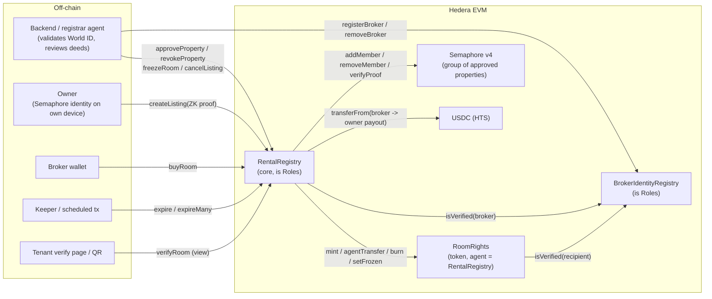
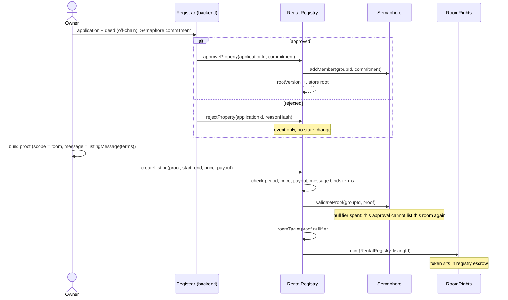
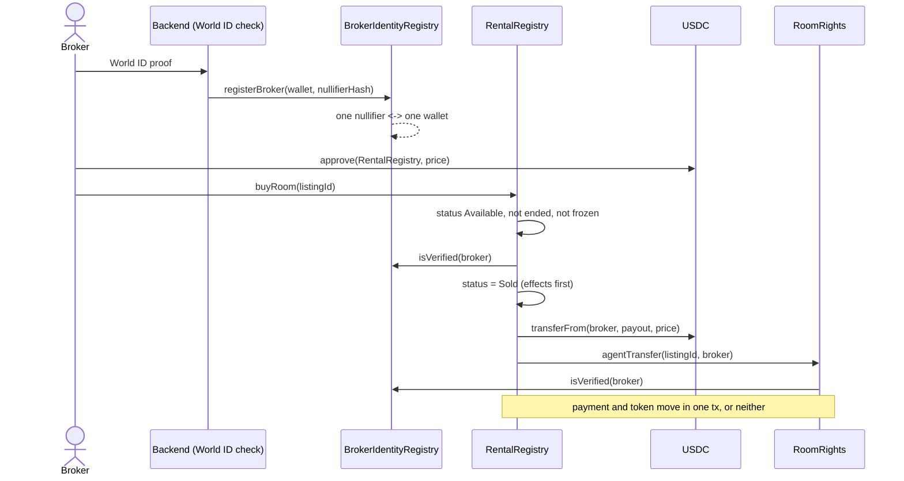
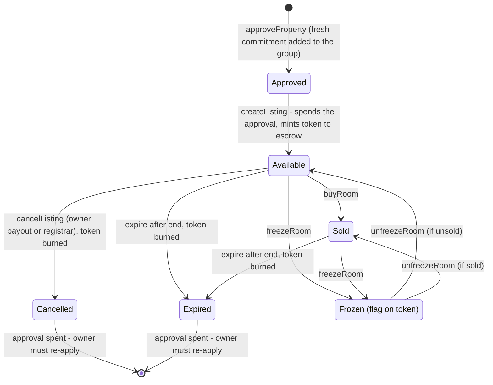
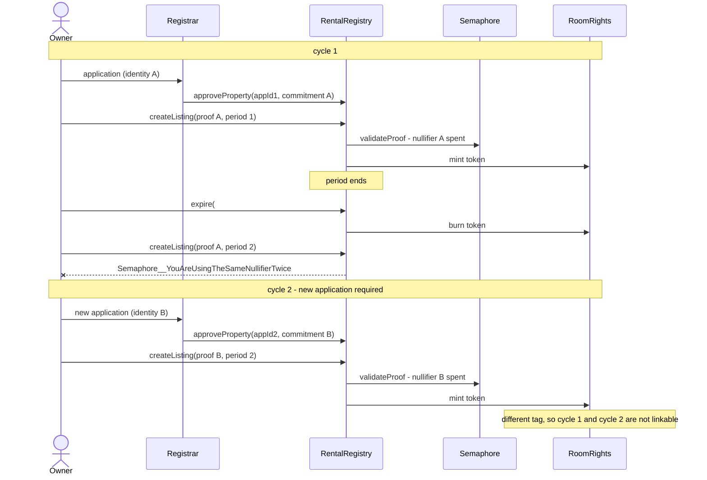
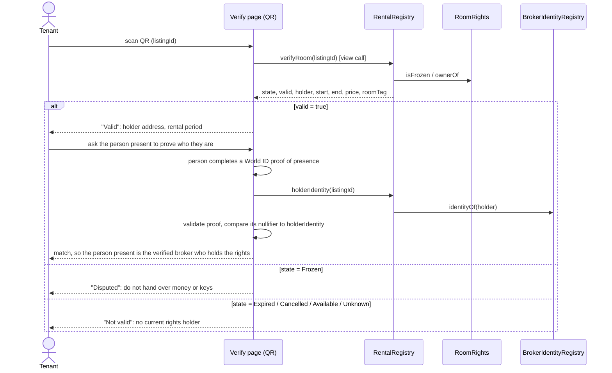

# Semaphore v4 on Hedera testnet, with Foundry (RentMeOut)

Deploys the official, unmodified Semaphore v4.14.5 contracts (`PoseidonT3`, `SemaphoreVerifier`,
`Semaphore`) and checks that a real Semaphore proof verifies on Hedera's EVM.

Needs: Foundry, Node 18+ (for npm packages and the proof fixture).

## Run

```bash
npm install                 # Semaphore + Poseidon sources; also copies lean-imt into lib/
forge test -vv              # 8 tests on a local EVM, no keys needed
cp .env.example .env        # add your Hedera testnet ECDSA key
./sh/deploy.sh              # PoseidonT3, then SemaphoreVerifier + Semaphore -> deployments/296.json
./sh/smoke.sh               # group + 3 members, then verifyProof via eth_call on Hedera
```

`smoke.sh` ends with `SMOKE TEST PASSED` when the valid proof returns `true` and a proof with
altered listing terms returns `false`. The proof check runs through `cast call`, so it executes on
Hedera's EVM, not in forge's local simulation.

## Why it's split into two steps

`PoseidonT3` is a linked library. Forge can auto-deploy libraries, but may use a CREATE2 factory
that Hedera doesn't necessarily have. `deploy.sh` deploys PoseidonT3 with `forge create` first, then
runs `script/Deploy.s.sol` with `--libraries`, which only uses plain `CREATE`.

## Tests (`test/Semaphore.t.sol`)

| Test | Shows |
|---|---|
| ApprovedOwnerProofVerifies | Owner #2's proof verifies; fixture root equals on-chain root |
| TamperedListingTermsRejected | Changing price or payout breaks the proof |
| TamperedProofPointsRejected | Forged proof data is rejected |
| ProofNotValidForAnotherGroup | Proof is bound to the registrar's group |
| VerifyDoesNotConsumeNullifier | `verifyProof` is the read-only check; `RentalRegistry` uses `validateProof`, which does consume the nullifier |
| OnlyRegistrarCanApprove | Only the group admin adds properties |
| RevokedPropertyStopsProvingAfterWindow | After removal, old proofs die once the 5-minute window passes |
| GasReport_VerifyProof | ~239k gas for `verifyProof` |

## Fixture

`fixtures/proof.json` is generated by `npm run fixture` from **fixed demo identities**, so the
same group root (and proof) works on every chain. Real owners must create a random `Identity` on
their own device, and a **new one for every application**, since an approval is single-use.
Regenerate after changing the demo listing terms in `js/make-fixture.js`.

The fixture holds two cycles: `proof` is the first listing (identity #2, three approved members),
and `cycle2` is the re-application after it expired - a fourth commitment and a proof for a later
period, with a different room tag.

## If something fails on Hedera

- Gas or pricing errors: rerun with `FORGE_EXTRA="--legacy"` or `FORGE_EXTRA="--gas-estimate-multiplier 200"`.
- Rate limits on the public relay: set your own `HEDERA_RPC_URL`, or rerun (`--slow` is already on).
- Account errors: the key must be ECDSA and funded from the testnet faucet.

## Notes for RentalRegistry

- Call `validateProof`, not `verifyProof`: it consumes the nullifier, which is what makes an
  approval single-use and blocks proof replay. One approval buys one tokenisation of one room.
- Use the proof's nullifier (scope = room index) as the private room tag. Because it derives from
  the identity secret, a re-application yields a different tag, so cycles are not linkable.
- Create the group from RentalRegistry so only the registrar flow can add or remove properties.

## Rental contracts (`src/`)

| Contract | Role |
|---|---|
| `RentalRegistry` | Core. Registrar approves/revokes properties (Semaphore group admin). Owners list rooms with a ZK membership proof; brokers buy atomically with USDC; freeze, cancel, expire. |
| `RoomRights` | One supply-1, 0-decimal token per room period (listing id == token id). ERC-3643-style: recipient must be verified, freeze, forced burn. Holders cannot transfer (no resale). Created by `RentalRegistry`, which is its only agent. |
| `BrokerIdentityRegistry` | Verified-broker list. One World ID nullifier <-> one wallet. |
| `Roles` | Owner + registrar wallets. |
| `DemoUSDC` | Testnet settlement token: 6-decimal ERC-20 with an **open** faucet, so brokers skip HTS association and any wallet can be funded. Testnet only. |

**Registrar:** `approveProperty(applicationId, commitment)`, `revokeProperty(commitment, siblings)`, `rejectProperty(applicationId, reasonHash)`, `freezeRoom` / `unfreezeRoom(id, reasonHash)`, `cancelListing(id)`; identity: `bindIdentity(identityKey, wallet)` (or `registerBroker(wallet, nullifier)`), `removeBroker(wallet)`, `bindSession(sessionKey, wallet)`.
**Tenant page:** `sessionMatchesHolder(sessionKey, holder)` after reading `holderOf(id)` - see [Tenant verification](#tenant-verification).
**Owner:** `createListing(proof, start, end, price, payout, latitudeE6, longitudeE6)`. Coordinates are signed decimal degrees at six decimal places. The proof message binds the period, price, payout, and coordinates, so a relayer cannot replace the reviewed pin. The call spends the approval: listing the room again needs a new application.
**Broker:** `buyRoom(id)` after `approve(registry, price)` on USDC.
**Anyone:** `expire(id)` / `expireMany(ids)` (keeper), and views `verifyRoom(id)`, `isValid(id)`, `roomState(id)`, `holderOf(id)`, `holderIdentity(id)`, `approvedRoot()`, `listingsOfRoom(tag)`.

### Deploy and verify

```bash
./sh/deploy.sh                                    # PoseidonT3 + SemaphoreVerifier + Semaphore
forge script script/DeployRegistry.s.sol  --rpc-url $HEDERA_RPC_URL --private-key $HEDERA_PRIVATE_KEY --broadcast --slow --legacy
forge script script/DemoFlow.s.sol        --rpc-url $HEDERA_RPC_URL --private-key $HEDERA_PRIVATE_KEY --broadcast --slow --legacy
forge script script/VerifyLive.s.sol      --rpc-url $HEDERA_RPC_URL --private-key $HEDERA_PRIVATE_KEY --broadcast --slow --legacy
```

`DeployRegistry` deploys a `DemoUSDC` faucet unless `USDC_ADDRESS` is set, and writes every
address into `deployments/<chainid>.json`. Set `REGISTRAR=0x...` to add the backend agent as a
second registrar. `DemoFlow` drives the whole product flow with the fixture (approve, verify a
broker, list, buy) and `VerifyLive` asserts a deployment is healthy, exercising session rotation
and the dispute freeze; both exit non-zero on failure.

### Live on Hedera testnet (chain 296)

| Contract | Address |
|---|---|
| `RentalRegistry` | [`0xCB63F343D4b4151bfe75E8617144e72E99D7667B`](https://hashscan.io/testnet/contract/0xCB63F343D4b4151bfe75E8617144e72E99D7667B) |
| `BrokerIdentityRegistry` | [`0x87081bAA3a6F0518f16d787e53754c5fD6a6Dac9`](https://hashscan.io/testnet/contract/0x87081bAA3a6F0518f16d787e53754c5fD6a6Dac9) |
| `RoomRights` | [`0x929f2547c0aa473Dcd22f4a7897C20782c1A1BC2`](https://hashscan.io/testnet/contract/0x929f2547c0aa473Dcd22f4a7897C20782c1A1BC2) |
| `DemoUSDC` | [`0xDf44cFf3dD65135b2d7Ec45b77BE85ae8dAa2876`](https://hashscan.io/testnet/contract/0xDf44cFf3dD65135b2d7Ec45b77BE85ae8dAa2876) |
| `Semaphore` | [`0xA9bdBf426F52dC24ced44aEb36Bd8F6bd580C067`](https://hashscan.io/testnet/contract/0xA9bdBf426F52dC24ced44aEb36Bd8F6bd580C067) |

The location-aware registry starts with approved-property group `1` and no members; each
property must be reviewed and approved again on this registry. The previous registry at
`0xb7Bd37F38129A93f49CeF030E63Cfb48D6F52e9E` remains live for its two active listings. The
app reads and supports purchases on those legacy listings while new approvals and listings
use the location-aware registry.

Caveats:
- `RoomRights` is a self-contained stand-in for an ATS token (the ATS integration is unverified). `RentalRegistry` only needs mint/transfer/freeze/burn/ownerOf from it.
- On Hedera, the buyer and owner payout must both be associated with the HTS USDC token, or `buyRoom` reverts with `PaymentFailed`.
- Revoking a property: old proofs still work until the 5-minute root window ends; freeze already-listed rooms explicitly.
- Double-booking across cycles is **not** caught on-chain. Two approvals of the same room give two different tags, so the registrar must not approve a fresh application while that room's period is still live.
- Old spent commitments stay in the Semaphore group and grow the tree. Use `revokeProperty` to prune them once their listing has expired.
- Hedera has no native timer for `expire`; a keeper (or scheduled transaction) must call it. `roomState`/`isValid` already report expiry correctly without it.

## Contract walkthrough

### Contract map



### Property approval and listing



### Broker verification and purchase



### Listing lifecycle

One approval produces exactly one listing of one room. The approval is spent at
`createListing`, so `Cancelled` and `Expired` are both terminal: the only way back to a listed
room is a new application and a newly approved commitment, which mints a new token.



### Re-approval cycle



### Tenant verification

The tenant never sends a transaction and needs no wallet. They scan the QR code at the room, and the verify page reads the chain.



What the tenant can rely on:
- `valid` is true only when the room is `Sold`, not frozen, and the current time is inside `[start, end)`.
- `holder` is the broker wallet that bought the rights. It is the zero address if unsold, cancelled or expired.
- `state` is computed on read, so an ended period shows `Expired` even if nobody has called `expire` yet.
- `roomTag` is the private room tag (a nullifier). It identifies this listing's room without revealing the property, and it changes on every re-application, so it cannot be used to track a room across cycles.
- The chain only says which wallet holds the rights. Checking that the person present is that broker is done with a World ID proof of presence, handled by the verify page and backend. No contract function does it.
- The link between the proof and the holder is the nullifier. `RentalRegistry.holderIdentity(listingId)` returns (from `BrokerIdentityRegistry.identityOf(holder)`) the nullifier hash recorded at registration. The verify page validates the new proof and compares its nullifier to that value. The same World ID action must be used at registration and at verification, because a nullifier is derived per action. If the actions differ, the values will not match and the backend has to map between them.

### `Roles.sol`
Abstract base for two-role access control. One `owner` plus a set of `isRegistrar` wallets. The constructor makes the owner a registrar too. `onlyOwner` guards `setRegistrar` and `transferOwnership`; `onlyRegistrar` guards the privileged calls in the two contracts that inherit it. `transferOwnership` is one-step and does not drop the old owner's registrar flag.

### `interfaces/IBrokerIdentity.sol`
Two-function interface: `isVerified(address) -> bool` and `identityOf(address) -> uint256` (the World ID nullifier hash). It lets `RentalRegistry` and `RoomRights` depend on the identity registry without importing it.

### `BrokerIdentityRegistry.sol`
The ERC-3643-style identity registry, plus World ID session bindings. The backend validates a World ID proof off-chain, then a registrar calls `registerBroker(wallet, nullifierHash)`.
- Two mappings, `identityOf[wallet]` and `walletOf[identity]`, enforce a strict one-to-one link.
- `registerBroker` reverts with `ZeroValue`, `IdentityAlreadyLinked` or `WalletAlreadyVerified`.
- `removeBroker` clears both sides, so the person can register another wallet later.
- The contract does not verify the World ID proof itself. Registrars are trusted.

It also holds the **session** bindings the tenant check needs. World ID 4.0 allows one nullifier per person per action and has no repeat-verification setting, so a broker proving presence at a viewing cannot re-run the enrollment action; they prove the session minted during enrollment (`IDKit.proveSession`) instead.
- `bindSession(sessionKey, wallet)` is registrar-only. A session may be re-bound to the same wallet, never moved to another (`SessionAlreadyBound`). Binding a new session to a wallet drops its previous one, so only the newest session can prove presence.
- `sessionMatchesHolder(sessionKey, holder)` is the tenant-side check: is this proven session the current holder's? False for an unknown session, a superseded one, or a zero holder.
- `removeBroker` clears the session along with the identity.
- The app derives both keys in `lib/world/keys.ts`: `identityKey = keccak256(action, nullifier)` and `sessionKey = keccak256(sessionId)`. The identity API is offered in `bytes32` (`bindIdentity`, `walletOfIdentity`, `identityOfWallet`, `isIdentityBound`) and `uint256` (`registerBroker`, `identityOf`, `walletOf`) shapes over the same storage.

### `RoomRights.sol`
A permissioned, NFT-shaped token. Supply is 1 per room period, 0 decimals, and token id equals listing id.
- `agent` is the `RentalRegistry` (set at construction). Only the agent can `mint`, `agentTransfer`, `burn` and `setFrozen`.
- `canTransfer(tokenId, to)` is true if the token is not frozen and `to` is the agent (escrow) or a verified broker.
- `burn` works even when frozen and clears the freeze flag.
- `transferFrom` always reverts (`TransfersDisabled`). There is no resale.
- It is a stand-in for an ATS-issued token. The registry only needs `mint`, `agentTransfer`, `burn`, `setFrozen`, `isFrozen` and `ownerOf`.

### `RentalRegistry.sol`
The core. The constructor creates the Semaphore group (this contract is its admin) and deploys its own `RoomRights`.

**Privacy model.** The registrar approves an opaque Semaphore identity commitment, never an address. An owner lists a room with a proof that "some approved property authorises these exact terms".
- The proof's `message` must equal `listingMessage(room, start, end, price, payout, latitudeE6, longitudeE6)`. This stops anyone altering price, dates, payout, or map pin on a valid proof.
- The proof's nullifier (scope = room index) is the private room tag.
- It calls `validateProof`, so the nullifier is spent in the Semaphore group. **One approval, one tokenisation:** an approved commitment can list a given room exactly once, ever. Once that listing is cancelled or expires, the token is burned and the approval is gone, so the owner must re-apply and have a fresh commitment approved to list the room again. Every cycle mints a brand-new token from scratch.
- Because the tag derives from the identity secret, a re-application produces a different tag. Cycles of the same room are therefore unlinkable on-chain. The trade-off: the contract can no longer detect a double-booking made through two separate approvals of the same room, so the registrar must not approve a fresh application while that room's period is still live.

| Area | Functions | Notes |
|---|---|---|
| Properties | `approveProperty`, `revokeProperty`, `rejectProperty` | Registrar only. Each approve/revoke bumps `rootVersion` and records the root and timestamp. Revoked proofs stay valid until the group's root window ends. |
| Listing | `createListing`, `cancelListing` | Checks period, price, payout and the term binding, then spends the proof via `validateProof`. Mints the token to escrow. Cancel is allowed for the payout wallet or a registrar, and only while `Available`; it does not give the approval back. |
| Purchase | `buyRoom` | `nonReentrant`. Needs `Available`, not ended, not frozen, and a verified broker. Sets `Sold`, pulls USDC from broker to payout, then transfers the token. |
| Disputes | `freezeRoom`, `unfreezeRoom` | Registrar only. Sets the freeze flag on the token. A frozen room cannot be bought. |
| Expiry | `expire`, `expireMany` | Anyone can call them after the end time. They burn the token. The batch version skips entries that cannot be expired. |
| Views | `verifyRoom`, `isValid`, `roomState`, `holderOf`, `holderIdentity`, `approvedRoot`, `listingsOfRoom`, `getListing` | `isValid` is true only when `Sold`, not frozen and inside the period. `roomState` reports `Expired` once the end time passes, even before `expire` is called. |

### `Fixture.sol` (test helper)
A library for `forge test`, not deployed. It reads `fixtures/proof.json` (written by `npm run fixture`) with `vm.parseJson*` cheatcodes and returns the member commitments, the `SemaphoreProof` struct and the removal siblings.
