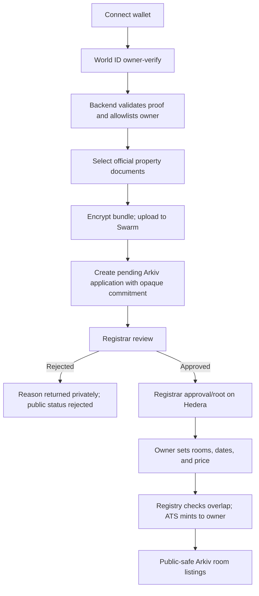
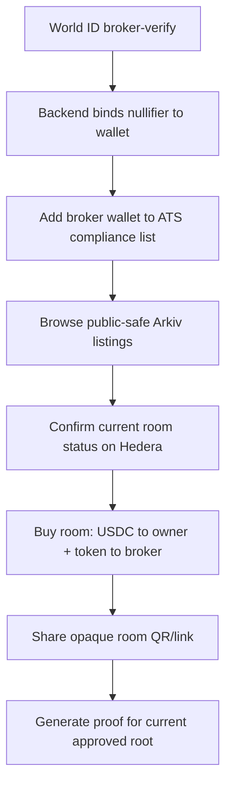
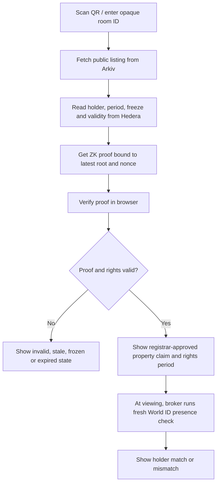

# Web3 Data Plan — Arkiv + Swarm + ZK

## Goal

Give owners a way to submit official home documents, let the registrar review them, and let brokers and tenants verify a room's approval and rental rights without publishing the property's exact identity or deed.

**Core rule:** Arkiv is the public, searchable index; Swarm holds encrypted files; Hedera holds authoritative room rights; ZK proves a claim about a registrar-approved commitment. Each system has a distinct job.

**Retention requirement:** once the tenant handoff is confirmed, delete tenant/session data and the platform's private copy of the submitted home documents and their decryption material. Keep only the minimum opaque proof and current room-rights record needed to verify the active rental period; remove those public index records when the period ends.

## Important trust boundary

A ZK proof cannot decide whether a deed is genuine or whether it actually describes the physical home. A registrar (or another trusted, legally-authorized source) must check that evidence and issue an approval attestation. ZK then lets the owner, broker, or tenant prove that the attestation is valid and linked to a room without revealing the address or deed. The UI must call this **“registrar-verified property evidence”**, not a cryptographic guarantee of title.

## What each system stores

| System | Store here | Never store here |
|---|---|---|
| **Arkiv** | Opaque application/listing IDs, state, room token reference, rental dates, price, coarse public locality, property/room commitments, proof root/version, expiry | Deed text, exact address, personal identity documents, raw World ID proofs, unwrapped Swarm decryption key |
| **Swarm** | Encrypted deed PDF, sensitive property details, private original photos, optional encrypted evidence bundle | Plaintext documents or unencrypted address book |
| **Hedera / RentalRegistry + ATS** | Property commitment approval/revocation state or active root, room commitment, token ID, dates, holder, payment, freeze/burn state | Deed, exact address, owner legal name, private World ID data |
| **Private application database / key vault** | Encrypted Swarm key/reference, owner-to-application mapping, World ID nullifier-to-wallet binding, registrar access audit, private proof witness | Public marketplace source of truth or funds/tokens |
| **Browser memory** | User-selected document before upload, proof input/output while verifying, short-lived viewing challenge | Persistent raw proof logs, long-lived decryption keys, analytics payloads with private data |

Arkiv entities are readable/queryable by their intended public readers. Treat every field written to Arkiv as public, including entity keys and metadata. Put only public-safe attributes in the entity. If an opaque Swarm content address is included, never include its decryption key.

## Actors and access

| Actor | May write | May read | Must not receive |
|---|---|---|---|
| **Owner** | Property application, room listing, owner-signed upload/consent | Their own application, deed receipt, listing state, proof package | Other owners' deed data or registrar signing keys |
| **Registrar** | Approval/rejection attestation, approved-root updates, dispute/revocation actions | Deed and supporting evidence through an audited restricted path | Owner's wallet/World ID secret material |
| **Broker** | Purchase and viewing proof requests | Public room listing, current rights status, approved-property proof; private viewing location only when owner shares it | Deed, deed key, unrelated property data, owner legal ID |
| **Tenant** | Short-lived public verification request; no account required | Public room status, proof result, rights period, broker match result; viewing location shared for the visit | Deed, owner identity documents, broker's raw World ID proof |
| **Backend/indexer** | Arkiv index records, encrypted uploads, chain event reconciliation | Minimum data needed to orchestrate requests | Unrestricted/developer access to private document keys or proof witness |

The registrar is an additional platform operator role, even though the main product actors are Owner, Broker, and Tenant.

## Data model

### 1. `PropertyApplication` — Arkiv

Public-safe fields:

```text
applicationId: opaque random identifier
ownerWallet: wallet address or app-level pseudonym, according to the chosen privacy policy
propertyCommitment: randomized hiding commitment (not a plain address hash)
documentCommitment: hash of encrypted document bundle, not a hash of the plain deed
swarmAddress: optional public Swarm address only (never the key-bearing full reference)
status: pending | approved | rejected | revoked
schemaVersion: integer/string
submittedAt: timestamp
decisionAt: timestamp (optional)
attestationRootVersion: integer (set on approval)
expiresAt: Arkiv entity expiry
```

Keep exact address, parcel number, owner's legal name, original deed, private photos, salt, and decryption material out of this entity. Avoid a deterministic property ID derived from the address.

### 2. `RoomListing` — Arkiv

```text
listingId: opaque random identifier
propertyCommitment: opaque randomized commitment
roomCommitment: opaque commitment bound to this room and period
roomLabel: public-safe name, e.g. "Room 2"
locality: optional coarse city/area, approved by owner for public display
publicDescription: sanitized, owner-approved description
publicPhotoRefs: optional images with owner consent and EXIF/location metadata removed
startAt / endAt: timestamps
priceUSDC: one-time room-rights purchase price
tokenAddress / tokenId: Hedera ATS reference
status: available | sold | frozen | cancelled | expired
attestationRootVersion: root used for the proof package
```

Do not publish a precise address just to enable discovery. Deliver it to a selected broker through an encrypted, access-controlled channel when needed to arrange the viewing.

### 3. `RightsRecord` — Arkiv

```text
listingId / roomCommitment
tokenAddress / tokenId
holderWallet (public chain state; include only if product chooses to expose it in index)
validFrom / validUntil
status
hederaTransactionId
expiresAt
```

Arkiv is a projection for search. Always confirm live holder, validity, freeze, and burn state from Hedera before showing a rights claim as current.

### 4. Private `PropertyWitness` — encrypted private store

```text
canonicalAddressAndParcelDetails
propertyCommitmentSalt
documentBundleSwarmAddress
documentBundleDecryptionMaterial (encrypted to authorized recipients)
registrarAttestation / private inclusion path material
optional room inventory details
```

This witness is used by the prover but never written as public Arkiv attributes or on-chain calldata. Prefer a client-side witness package encrypted to the owner and registrar, or a narrowly scoped prover service with encrypted storage, strict access logs, and deletion rules.

## File and key handling

1. Owner selects the official deed and supporting documents.
2. Encrypt before upload. For Swarm's built-in encrypted upload, use a private/local Bee node or a transport path with TLS that the team controls; never send a key-bearing full reference to a public gateway.
3. Keep the Swarm decryption key separate from the content address. Store it in a server-side key vault or wrap it to the owner's and registrar's public keys. Do not put it in Arkiv, URLs, logs, analytics, or browser local storage.
4. Save only the public-safe opaque application ID and, if useful, the Swarm address without its key in Arkiv. Keep the key-bearing reference in the protected key store.
5. Registrar requests a short-lived document view. Backend authorizes the registrar, retrieves/decrypts the file through a protected service, and records the access event.
6. Encrypt exact location and sensitive photos the same way. Public photos must be explicitly owner-approved and stripped of EXIF/geolocation data.

Swarm's encrypted upload reference includes both a public Swarm address and a decryption key; possession of the full reference grants read access. Swarm encryption is not an access-control list, and access cannot be revoked from someone who already has the key. For production, use per-document keys and re-encrypt/reissue a new object when access must be revoked.

### Approved handoff design: private key service, Arkiv expiry metadata only

The deed key and any wrapped/encrypted copy of it must stay out of Arkiv. Arkiv is public, and expiration only removes an entity from current queries; it is not a secure-erasure guarantee. The public `PropertyApplication` entity may contain an opaque `applicationId`, public-safe owner/status fields, and its expiry block. A private key service maps that opaque ID to the Swarm reference and an envelope-encrypted data key.

1. The owner browser encrypts the deed with a fresh per-deed AES-GCM key and uploads only ciphertext to Swarm.
2. The browser sends the key and Swarm reference over TLS to the private key service. The service immediately wraps the key with a managed KMS key and persists the wrapped key, reference, application ID, Arkiv expiry block, and lifecycle state in a durable private store. Do not log request bodies or keys.
3. The platform creates the public Arkiv application entity with only the opaque application ID, public-safe fields, and an expiry. It does not include the Swarm reference, key, wrapped key, access token, or a pointer to a key envelope.
4. A registrar must authenticate with a separately configured, allowlisted registrar identity. The key service checks that identity and that the application is pending before issuing a short-lived, one-time document view. It should stream the decrypted PDF through a `no-store` route rather than return the raw key to the browser.
5. Once verification is recorded, the key service revokes the grant and destroys the wrapped per-deed key. It also destroys keys when the application deadline is reached. Arkiv expiry metadata is copied into the private record as a deadline; Arkiv does not send an expiry callback, so private cleanup must use a scheduler/TTL mechanism.

This keeps the key and ciphertext envelope invisible to Arkiv readers. The public entity may still be copied before deletion/expiry, but it contains no material that can decrypt the deed. A registrar who has viewed the plaintext can still copy it; no remote system can force a human recipient to forget or delete a downloaded copy.

The current demo implements a manual key-file handoff instead of this key service: the owner adds the Arkiv application key to the downloaded key file and shares it with the assigned registrar through a secure channel. The registrar imports it in the browser, decrypts the deed locally, and records a decision in a separate Arkiv entity owned by the registrar wallet. The app filters decisions by the configured registrar wallet allowlist. This supports a testnet demo, but it is not server-enforced authorization, a durable key vault, or a production review service. Production still requires a durable private store, KMS-managed key wrapping, audited registrar authentication, access auditing, and lifecycle cleanup.

## Handoff trigger and deletion policy

In the current product model, the broker holds the on-chain rental-right token; the tenant receives occupancy under an off-platform rental agreement. The deletion trigger is therefore **tenancy handoff confirmed**, not transfer of the ERC-3643 token to the tenant. Represent the trigger as `TenancyActivated(listingId, roomId, handoffId)` with no tenant name, phone, email, ID, exact address, or lease contents.

Use two-party confirmation: the broker marks the room as handed over, and the tenant confirms through a single-use QR/link challenge. The tenant does not need an account or wallet. The random challenge is bound to the room and current rights period, expires quickly, and is deleted after use. Once both confirmations are valid, write a minimal activation event/record and enqueue an idempotent deletion job.

### Delete at confirmed handoff

- Delete any temporary tenant contact/session/verification records. Prefer not to collect contact details or tenant identity documents at all.
- Delete the tenant handoff challenge, one-time session state, and temporary upload buffers.
- Delete the platform's private deed bundle copy and property-detail witness used by the prover after the approval attestation and proof package are safely created.
- Destroy the associated Swarm decryption key/full reference in the key vault and remove all active pointers, caches, logs, and local pins controlled by the application.
- Delete the `PropertyApplication` Arkiv entity and handoff-only entities when no longer needed. Keep the minimum `RoomListing`/`RightsRecord` state required to verify the active rental right; expire or delete it at the rights end date.
- Retain only the salted opaque property commitment, registrar attestation/root membership, room commitment, token ID, validity period, freeze state, and transaction references needed for current rights verification and dispute handling. Do not retain the address, deed, tenant identity, or a deterministic document hash in these records.

Arkiv entities can be deleted before expiry by their owner. To make cleanup reliable, create application/index entities from the platform's cleanup-capable Arkiv wallet (or transfer ownership to it); otherwise the owner's wallet must sign the delete operation. Deleting an entity removes it from the live query surface, but do not put secrets or personal data into Arkiv on the assumption that deletion erases every historical copy.

Swarm content is immutable and has no general delete operation. The practical deletion action is **crypto-erasure**: destroy all controlled decryption material and remove pointers/pins. This makes stored ciphertext unreadable to the platform, but cannot erase copies already downloaded by an authorized reviewer or guarantee immediate removal of ciphertext from every peer. Swarm ACT can manage future access, but previously granted historical versions or downloaded plaintext may remain accessible. Never share a key-bearing full reference with a broker or tenant.

The verification page still needs to answer whether the room's token is current, who holds the rights, whether it is frozen, and when the period ends. Keep that minimum opaque public state while the right is active. At expiry, expire/delete the Arkiv listing and proof index and remove the property commitment from the active approval root if revoked. A tenant handoff must not erase the active rights record immediately, or the tenant cannot verify it during occupancy.

```mermaid
stateDiagram-v2
  [*] --> PendingReview
  PendingReview --> Rejected: registrar rejects
  PendingReview --> Approved: registrar approves
  Approved --> Listed: owner lists room
  Listed --> SoldToBroker: atomic USDC + token transfer
  SoldToBroker --> HandoffPending: broker starts tenant handoff
  HandoffPending --> SoldToBroker: tenant does not confirm / challenge expires
  HandoffPending --> TenancyActive: broker + tenant confirm
  TenancyActive --> PrivateDataPurged: delete tenant/session data; crypto-erase deed keys
  PrivateDataPurged --> RightsExpired: end date reached
  RightsExpired --> PublicIndexRemoved: Arkiv expires or entities are deleted
  Rejected --> PrivateDataPurged: rejection retention window ends
```

Use a retryable deletion queue and log only an opaque deletion job ID, completion time, and categories deleted. The log must not contain a name, address, Swarm key, document body, or tenant contact detail.

## End-to-end flow

```mermaid
sequenceDiagram
  actor Owner
  participant UI as Owner app
  participant World as World ID
  participant API as Backend/API
  participant Swarm
  participant Arkiv
  actor Registrar
  participant Registry as Hedera registry
  participant Prover as ZK prover
  actor Broker
  actor Tenant

  Owner->>UI: Connect wallet, verify, upload official home papers
  UI->>World: owner-verify action
  World-->>UI: Proof
  UI->>API: Proof + property fields + selected files
  API->>API: Validate identity proof; create random property salt/commitment
  API->>Swarm: Store encrypted document bundle
  API->>Arkiv: Create pending PropertyApplication (public-safe fields only)
  API-->>Owner: Application ID and pending status
  Registrar->>Arkiv: Query pending application
  Registrar->>API: Request restricted document review
  API->>Swarm: Fetch/decrypt via controlled path
  API-->>Registrar: Authorized document view
  Registrar->>Registry: Approve opaque property commitment / publish root
  Registry-->>Arkiv: Approval event
  Owner->>Registry: Create room listing and mint room tokens
  Registry-->>Arkiv: Listing event; indexer writes RoomListing
  Broker->>Registry: Buy a listed room right
  Registry-->>Arkiv: Sale event; indexer writes RightsRecord
  Tenant->>UI: Scan QR / request proof for room
  UI->>Registry: Read current room state, token holder, root/version
  UI->>Prover: Request proof bound to room + current root + nonce
  Prover-->>UI: ZK proof and public inputs only
  UI->>UI: Verify locally; show approved-property and rights results
```

## What the ZK proof establishes

### Proposed statement

For the opaque room commitment shown on a listing, the prover knows a private property commitment opening and registrar-approved attestation such that:

1. The property's commitment is included in the current approved-property Merkle root (or has a valid registrar signature and is not revoked).
2. The room commitment is derived from that property commitment, a room slot, and the exact rental period recorded for the room token.
3. The proof is bound to the latest on-chain root/version, a Hedera room/token identifier, and a short-lived tenant challenge.

### Public inputs

- active root and version read from Hedera;
- opaque room commitment/listing ID and token ID;
- rental period and lifecycle status read from Hedera;
- random short-lived verification nonce and expiry.

### Private witness

- actual address/parcel and any private attributes;
- high-entropy random salt used in the hiding commitment;
- registrar attestation inclusion path or signature witness;
- private room/property binding data.

Use a hiding commitment with a high-entropy salt, such as a Poseidon-based commitment, not `hash(address)` by itself. Common addresses can be guessed from a plain hash. Do not disclose the private witness as proof inputs or store it in Arkiv.

### Tenant result

The public page can report:

> Property evidence approved by the registrar. This room is linked to that approved property commitment. Room rights are valid through [date].

Then show the independent current-rights result from Hedera and, at a viewing, the separate World ID broker-presence match. The page need not show the actual address or deed. The owner can share the precise viewing address privately with the broker/tenant when required.

### Revocation and replay

- Freeze affected room tokens immediately for active disputes.
- Publish a new approved root/version when approval is revoked. A proof against an old root must be rejected.
- Bind each verification proof to a random nonce, room ID, current root, and short expiry. Prevent replay of the same viewing session if one-use semantics are required.
- Arkiv expiry hides expired entities from queries, but Arkiv emits no expiry event. Use Hedera's lifecycle as the authority and a worker/periodic query for off-chain cleanup.

## Role-specific flows

### Owner: submit evidence and create listings



### Broker: buy and prove current rights



### Tenant: verify without seeing the deed/address publicly



## Failure states

| Condition | Expected result |
|---|---|
| Invalid/cancelled owner verification | Do not create an application or allowlist owner |
| Same World ID identity attempts another wallet | Block duplicate binding; show support path |
| Swarm upload fails | Keep application as draft; do not publish as submitted |
| Deed decryption key unavailable | Show registrar access error; never mark review complete |
| Registrar rejects evidence | Arkiv status rejected, reason delivered to owner; no listing/token issuance |
| Arkiv record says approved but Hedera does not | Treat as unapproved and show syncing/error state |
| ZK root is stale/revoked | Reject proof and request a new proof against current root |
| ZK proof invalid or witness mismatched to room | Show verification failed; do not show a green badge |
| Hedera/Arkiv temporarily disagree | Hedera wins for rights status; indexer reconciles Arkiv |
| Broker-presence check fails | Red result; no personal proof data shown to tenant |
| Owner loses Swarm decryption material | Recovery path from protected key vault/owner backup; if none exists, document cannot be recovered |

## Build order

1. **Arkiv schemas and lifecycle:** property application, room listing, rights record; query and expiry behavior.
2. **Private Swarm upload:** encrypted test deed, protected full reference/key, registrar retrieval and audit.
3. **Registrar attestation:** approval/rejection writes opaque commitments and active root/version on Hedera; events update Arkiv.
4. **Room lifecycle:** mint at listing, purchase, freeze, cancel, expiry; verify every public status against Hedera.
5. **ZK prototype:** commitment opening + approved Merkle membership + room/period binding + nonce. Keep address/deed out of the proof output.
6. **Tenant verification page:** local proof verification, current root check, rights state, separate broker-presence check.
7. **Privacy/failure review:** inspect Arkiv fields, chain events, server logs, URLs, screenshots, and analytics for leaked address, document refs, keys, or World ID proof data.

For the hackathon demo, use a sample deed labelled as test data. Keep production legal review, key recovery, registrar governance, and circuit audit as later requirements.

## Primary documentation

- [Arkiv: create entities](https://docs.arkiv.network/writing/create/)
- [Arkiv: change and delete entities](https://docs.arkiv.network/writing/change/)
- [Arkiv: entity expiry](https://docs.arkiv.network/writing/expiration/)
- [Arkiv: read one entity](https://docs.arkiv.network/querying/get-entity/)
- [Swarm: encrypted upload](https://docs.ethswarm.org/docs/develop/tools-and-features/store-with-encryption/)
- [Swarm: access control and revocation](https://docs.ethswarm.org/docs/concepts/access-control/)
- [Swarm: mutable feeds and deletion limitations](https://docs.ethswarm.org/docs/develop/dynamic-content/)
- [Swarm: upload and download](https://docs.ethswarm.org/docs/develop/upload-and-download/)
- [Semaphore: proofs](https://docs.semaphore.pse.dev/guides/proofs)

